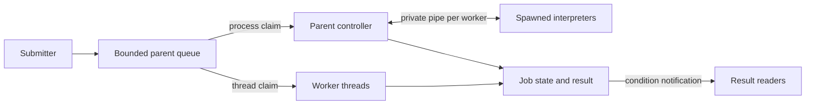

# TaskForge Runtime

TaskForge is a standard-library Python job runtime for studying what happens between submitting a callable and collecting its result. It runs bounded workloads on threads or spawned processes. Both backends use the same scheduler, so you can change execution models and observe the effects of memory isolation, IPC, backpressure and worker failure.

| Engineering question | Implemented behavior |
| --- | --- |
| What happens when producers outpace workers? | A bounded queue blocks or times out admission. Pending cancellation or expiry frees a slot. |
| Can urgent work starve an older job? | Higher priorities win among eligible entries, with FIFO ties and a configurable bound on bypassing the oldest entry. |
| What happens when a worker dies? | The parent fails its assigned attempt, retains its health record and continues with surviving workers. Losing the final worker resolves the remaining queue. |
| What can a caller verify? | Each job exposes state, attempt count and result. An immutable snapshot reconciles accepted jobs with pending, running and terminal counts. |

## Install and try it

From the checkout with Python 3.11 or newer, run these PowerShell commands. On Linux or macOS the virtual environment executables live under `.venv/bin/`.

```powershell
python -m venv .venv
.\.venv\Scripts\python.exe -m pip install .
.\.venv\Scripts\taskforge.exe --backend process --workers 2 --stats 2 3 4
```

The CLI prints each job ID, its square and the worker that ran it. The final JSON snapshot for these three inputs reports three completions and two exited workers. Omit `--backend process` to try threads.

```python
from taskforge import Runtime

with Runtime(workers=2, queue_capacity=4) as pool:
    print(pool.submit(pow, 2, 5).result(timeout=5))  # 32
```

For processes, run a saved script with a main guard. This example gives the job high priority and a five-second start window. Its result timeout bounds the caller's wait. The snapshot is taken after shutdown has joined both workers.

```python
from math import gcd
from taskforge import ProcessRuntime, Schedule

if __name__ == "__main__":
    with ProcessRuntime(workers=2, queue_capacity=4) as pool:
        job = pool.submit_scheduled(Schedule(priority=3, start_within=5), gcd, 84, 30)
        print(job.result(timeout=10))  # 6
    view = pool.snapshot()
    print(view.completed, view.stopped)  # 1 True
```

## How work moves



Threads share objects and can overlap blocking operations. Spawned processes own separate heaps and interpreters, which permits parallel Python execution on a GIL-enabled build. Starting processes and serializing each call costs time. The controller owns process job state and handles pipe failure. See the [architecture and job state machine](docs/architecture.md), [scheduling contracts](docs/scheduling.md) and [snapshot and logging examples](docs/observability.md).

## Measured performance

Median logical jobs per second on a Windows 11 laptop with a Core i7-14650HX, CPython 3.15.2, and 32 jobs per batch. Each cell uses three timed batches after a warm-up, with startup measured separately.

| Workload | 1 thread | 2 threads | 1 process | 2 processes |
| --- | ---: | ---: | ---: | ---: |
| Lightweight callable | 53,174 | 38,661 | 9,924 | 12,626 |
| 25,000 arithmetic iterations per job | 876 | 825 | 957 | 1,584 |
| 2 ms local wait per job | 394 | 801 | 387 | 770 |

The two-process pool improved throughput on this CPU workload. Two threads nearly doubled throughput on the waiting workload, and lightweight calls favored threads. Short batches are sensitive to OS scheduling. The [benchmark report](docs/benchmarks.md) includes ranges, contention, retries, lifecycle costs and reproduction commands.

## Verification and compatibility

The package declares Python 3.11+. Local Windows runs exercised 3.11.18, 3.12.14, 3.14.7 and 3.15.2, including real spawn and worker crashes. Python 3.13, Linux and macOS have static portability review only. WSL was unavailable on the test machine.

```sh
python -m unittest discover -v
python -m benchmarks
```

| Source location | What to review |
| --- | --- |
| `taskforge/scheduling.py`, `job.py` | Queue admission, fairness, retry reservations and terminal outcomes |
| `taskforge/scheduler.py`, `worker.py` | Thread startup, work loops, deadlines and joins |
| `taskforge/process_runtime.py`, `process_worker.py` | Spawn, serialization, IPC, supervision and cleanup |
| `taskforge/observability.py` | Immutable worker and runtime snapshots |
| `tests/`, `benchmarks/`, `docs/` | Coordinated race tests, workload measurements and engineering contracts |

The [Phase 5 verification record](verification-phase-5.md) contains the baseline, regression, stress, packaging and hygiene evidence. For a contribution, reproduce the relevant case, add a regression, and run the local gates listed there.

## Boundaries and release status

TaskForge runs trusted local Python code. Pickle can execute code during reconstruction. A start deadline governs the scheduler claim, and a result timeout governs one reader. A running callable can keep a joining shutdown waiting indefinitely. Retries are opt-in and suit idempotent operations. Jobs and results are in-memory, with no durable recovery or automatic worker replacement.

This checkout contains no project license or declared license grant. The repository owner should choose the license and its metadata before a public source release. The audited package version remains 0.4.0.
