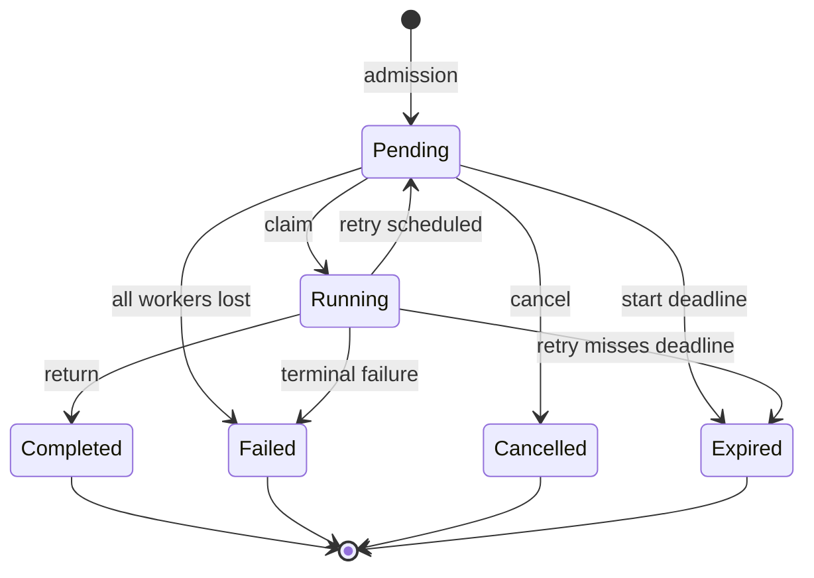

# Runtime architecture

## Job lifecycle



The job UUID survives retry transitions. A retryable failure can lead directly to expiry when the original start window has elapsed. Concurrent submitters contend for admission, then workers contend for eligible work. In process mode, only the controller makes claims. Cancellation, claim and deadline checks serialize on the same pool condition. A result reader waits on a separate per-job condition and releases it while sleeping.

## Scheduler architecture

The scheduler owns the accounting for both backends. Admission, claim, retry, terminal outcome and worker assignment update under the same condition that protects the queue. A snapshot acquires that condition once and copies counters and immutable worker records. It neither polls children nor sends a message. Transition accounting takes constant work per transition with logging disabled. Snapshot cost scales with worker count. The pool retains one health record per worker and aggregate counters, so observations do not keep completed job handles alive.

- **Shared policy** (`taskforge/scheduling.py`). One pool condition protects admission, reservations, the bypass counter and a dictionary of pending entries keyed by job ID. Selection scans the bounded queue in insertion order. Cancellation removes an item directly by ID. Both operations publish the state transition under the scheduler lock before another producer or worker can enter. A pool can have up to `queue_capacity + workers` accepted, unfinished jobs.
- **Timing**. Idle thread workers use timed condition waits for retries. A thread pool lazily starts one deadline timer while there are waiting deadlines, so busy workers can keep executing user code. The timer exits when there are no deadlines left. The existing process controller incorporates deadlines and retry eligibility into its pipe wait. All waiters recompute eligibility under the same lock.
- **Worker** (`taskforge/worker.py`). Each non-daemon thread waits on the scheduler condition, claims a job, releases the scheduler lock and calls the task. It publishes either the returned value or the raised exception before taking another job. Once admission closes and the queue empties, it exits.
- **Job** (`taskforge/job.py`). A per-job condition protects the state and outcome. A claim moves a pending job to running. An attempt may complete, fail, or return to pending for a retry. Waiting jobs may expire, be cancelled, or fail if the last worker is lost. Result readers wait on a terminal-state predicate. Cancellation releases the job lock before calling the scheduler, preserving the scheduler-to-job lock order.
- **Public API** (`taskforge/__init__.py`) exports the runtime, handle, states and exceptions. Runtime-specific exceptions live in `taskforge/errors.py`. The CLI uses the same submission and result APIs.

## Processes

Save this example in a Python file and run it as a script. Spawn starts a fresh interpreter that imports the entry module. The main guard keeps pool construction in the parent.

```python
from math import gcd
from taskforge import ProcessRuntime, Schedule

if __name__ == "__main__":
    with ProcessRuntime(workers=2, queue_capacity=4) as pool:
        job = pool.submit_scheduled(Schedule(priority=2, start_within=3), gcd, 84, 30)
        print(job.result(timeout=5))  # 6
```

| | Threads | Processes |
| --- | --- | --- |
| Memory | Workers share Python objects. Callers synchronize shared mutations. | Each worker has a separate heap. Ordinary arguments are snapshots and results are copies. A worker's own globals persist across its jobs. |
| CPU execution | On GIL-enabled CPython, one thread at a time executes Python bytecode per interpreter. Threads can overlap I/O and native work that releases the GIL. | Each worker has its own interpreter and GIL on GIL-enabled builds, allowing CPU-bound Python tasks to run simultaneously on different cores. |
| Cost | Arguments and results pass by reference. | Spawn imports modules in each worker. Pickling, copying and pipe transfers add latency and memory use. |
| Task functions | Accepts any callable. | Accepts importable, named module-level functions, including module-level built-ins such as `math.gcd`. Put custom functions in a separate importable module. Lambdas, closures, methods, callable instances and functions defined in the entry script or REPL are unsupported. |

### Admission and serialization

The process runtime uses pickle over private parent/child pipes. Submit **trusted functions and data**. Pickle reconstruction can execute Python code in either process. Arguments and results must support a complete pickle round trip in the receiving interpreter. Workers must have access to the same modules. For cooperative cancellation, tasks can check a caller-supplied, serializable signal such as a multiprocessing manager event proxy.

The submitting thread serializes the call before waiting for queue capacity. An unsupported function or an ordinary pickling error raises `SerializationError` before admission. The `submit_with_timeout` timeout covers the subsequent wait for space. Capacity includes pending jobs and retry reservations. It does not bound bytes or the memory used by callers preparing submissions.

### Dispatch and failure

One parent controller waits on worker pipes and a wake-up pipe. Each worker has one private connection and at most one assigned job. Under the queue condition, the controller selects an eligible job with the shared scheduling policy and marks it running before writing the request. A pending cancellation that takes the same lock first removes the job and frees the slot. Once the controller claims a job, `cancel()` returns false, including during dispatch.

| Event | Observable outcome |
| --- | --- |
| Task raises, including `SystemExit` | After any eligible retries, the job fails with `RemoteTaskError`. It includes the child traceback when formatting succeeds and the exception type when formatting fails. The worker can accept another job. |
| Task reconstruction, result encoding or parent result decoding fails | The job fails with `SerializationError`. The worker remains available. |
| Worker exits before the controller receives a complete reply | Its assigned job fails with `WorkerLostError`. Side effects may already have occurred. TaskForge never replays a lost worker's assigned job. A complete reply received before EOF is retained. |
| An idle worker exits | The controller detects EOF even without a new submission. Surviving workers continue serving the queue at reduced capacity. |
| The last worker is lost | Admission closes. Unclaimed jobs move directly from pending to failed with `WorkerLostError`. Blocked and subsequent submissions raise `RuntimeClosedError`. Create a fresh pool to restore capacity. |

### Startup, shutdown and timeouts

A process pool supports 1–60 workers and defaults to a 30-second shared startup handshake timeout. The limit on pool size keeps the controller's wait set within the Windows handle limit across supported Python versions. If construction fails, it cleans up the workers it started before admitting user work.

Shutdown drains by default. Pass `cancel_pending=True` to discard queued work, or `wait=False` to let cleanup continue in the controller. A joining `shutdown(timeout=seconds)` raises `TimeoutError` if cleanup is still in progress. Admission stays closed, and another call can finish the join. A result timeout limits only the caller's wait. Neither timeout stops a running task. The controller joins the children and closes the IPC and process handles before a joining shutdown returns. A task that never returns can keep its worker and the parent interpreter alive.

## Limits

Python threads cannot be forcibly terminated safely. A claimed job runs until its callable returns or raises. A callable that needs early termination can periodically check a caller-supplied `threading.Event`. An indefinitely blocked task can keep a joining shutdown and interpreter exit waiting indefinitely.

Scheduling governs claim order among eligible attempts. With multiple workers, the operating system can schedule their callable starts and completions in a different order. Producers competing for space have no fairness guarantee. A task that blocks on another job in the same saturated pool, or waits for space in its own full queue, can deadlock the application. Use an external coordinator or bounded waits for dependent work.

Queue contents and results live in memory in both backends. Worker replacement and durable recovery remain outside this phase. Selection and timer recalculation take linear time in queue length. Start windows and retry delays accept finite nonnegative seconds up to the platform's `threading.TIMEOUT_MAX`.

## Python API

```python
from taskforge import Runtime

with Runtime(workers=2, queue_capacity=4) as pool:
    job = pool.submit(pow, 2, exp=5)
    print(job.result(timeout=2))  # 32
```

| Operation | Behavior |
| --- | --- |
| `pool.submit(fn, *args, **kwargs)` | Waits for queue space and returns a pending or already-claimed job. All task arguments are forwarded. |
| `pool.submit_with_timeout(seconds, fn, *args, **kwargs)` | Raises `QueueFullError` if space does not become available in time. Zero attempts admission immediately. A timed-out submission never enters the queue. |
| `job.result(timeout=None)` | Waits for completion, returns the value, or raises the task's exception. Cancellation raises `JobCancelledError`. A wait timeout raises `TimeoutError` and the job continues. Multiple callers can retrieve the same outcome. |
| `job.cancel()` | Returns true to the caller that removes a pending job and immediately frees its slot. Returns false once the job is claimed, finished or already cancelled. |
| `pool.shutdown()` | Closes admission, wakes blocked submitters with `RuntimeClosedError`, drains accepted jobs and joins every worker. Context exit does the same, including on exceptional exit. |
| `pool.shutdown(wait=False, cancel_pending=True)` | Cancels queued jobs, wakes their result waiters and returns while claimed jobs finish. The two flags are independent. Call `shutdown()` later to join. |

Pool construction starts the workers. Shutdown is idempotent. After closure, create a fresh pool for another run. In the thread runtime, a worker may request shutdown using `wait=False`. A joining shutdown from a pool's own thread raises `RuntimeError` before changing admission.
